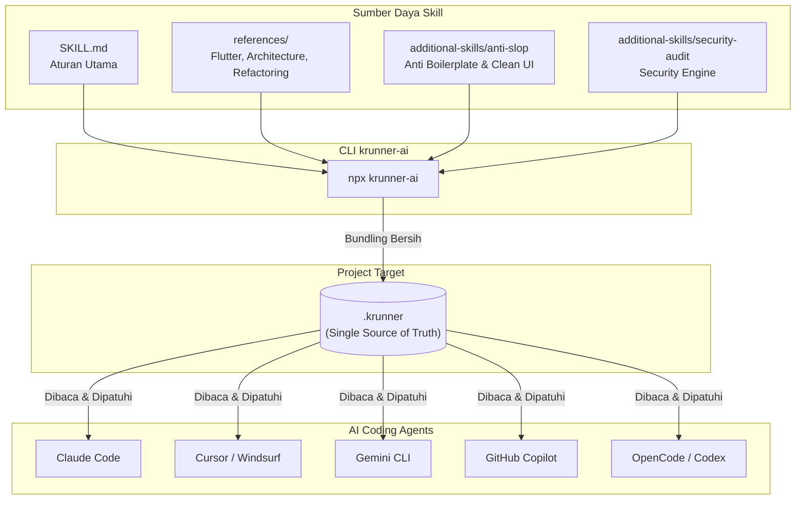
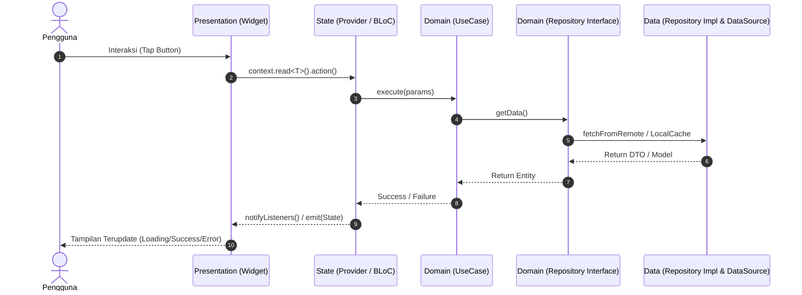
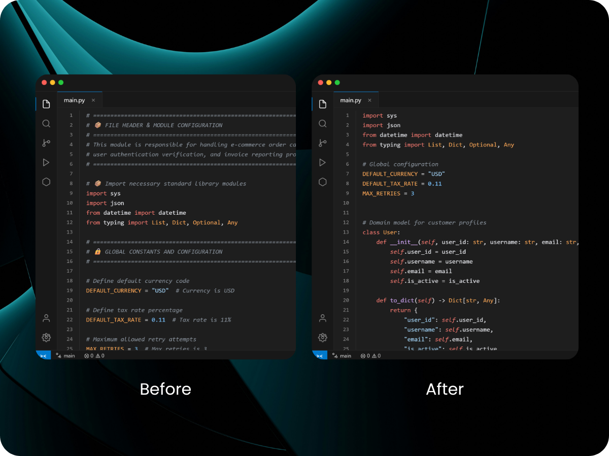
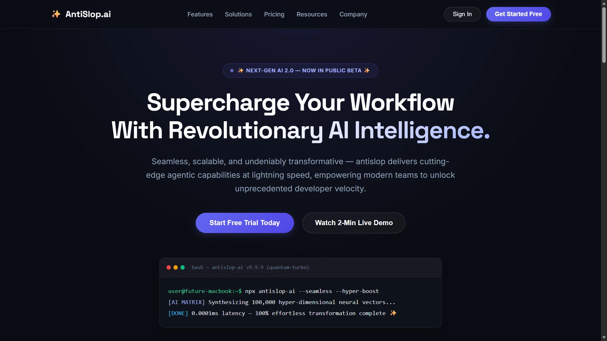
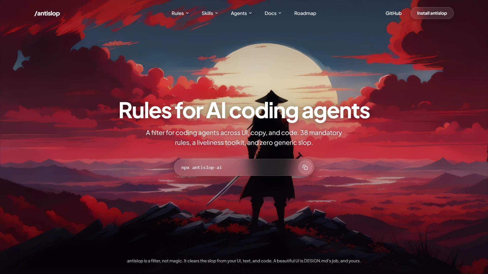
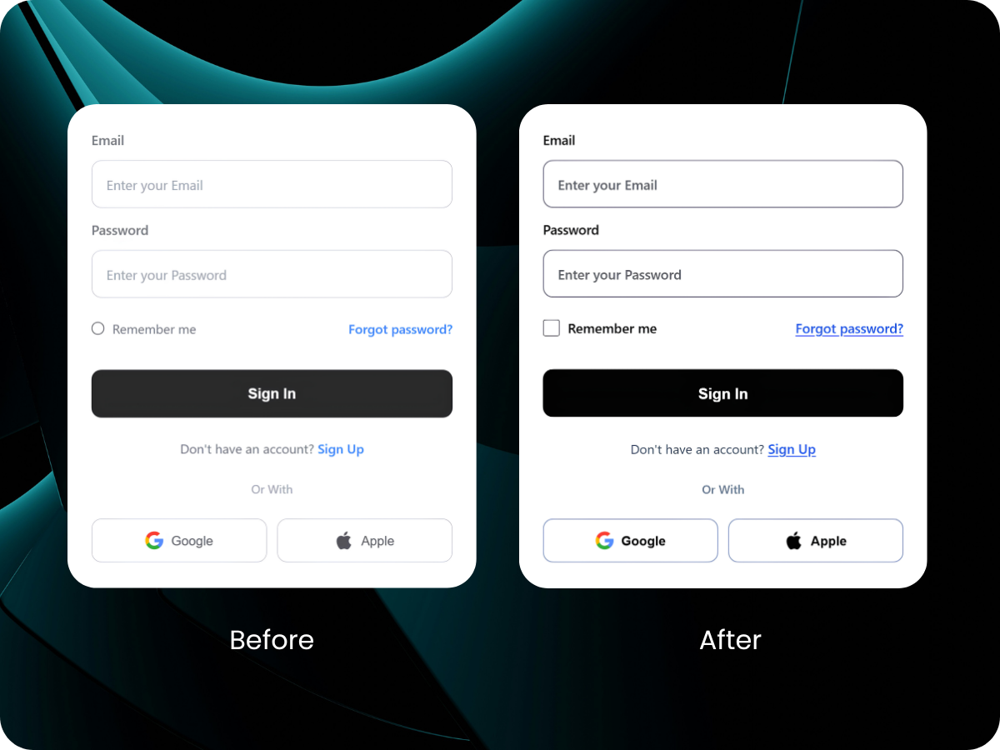
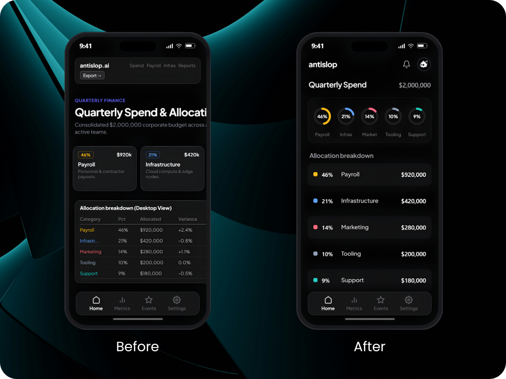
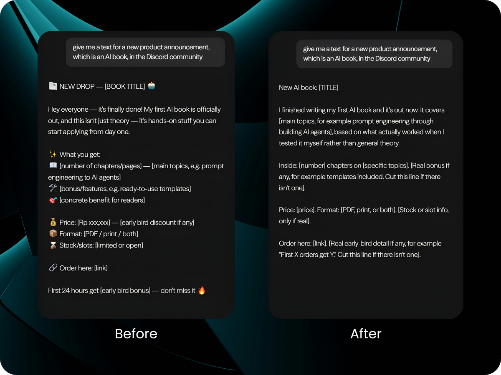

<p align="center">
  <picture>
    <source media="(prefers-color-scheme: dark)" srcset="assets/antislop-banner.png">
    <source media="(prefers-color-scheme: light)" srcset="assets/antislop-banner-light.png">
    
  </picture>
</p>

<div align="center">

# 🚀 Universal AI Coding Skill For Flutter

**Standar AI coding presisi tinggi untuk ekosistem Flutter & Dart.**  
Menggabungkan **Clean Architecture**, **Anti-Slop**, **Security Audit**, dan **Strict Execution Mode** ke dalam satu file standar `.krunner` yang dapat dipahami oleh AI mana pun.

```bash
npx krunner-ai
```

[](https://flutter.dev)
[](https://dart.dev)
[](krunner-ai/package.json)
[](LICENSE)
[](#dukungan-agen-ai)

</div>

---

## 📖 Daftar Isi
- [Kenapa Proyek Ini Dibuat?](#-kenapa-proyek-ini-dibuat)
- [Cara Pakai Cepat](#-cara-pakai-cepat)
- [Bagaimana Cara Kerjanya?](#-bagaimana-cara-kerjanya)
- [Pilar Standar Utama](#-pilar-standar-utama)
  - [1. Standar Wajib Flutter & Dart](#1-standar-wajib-flutter--dart)
  - [2. Alur Arsitektur Berlapis](#2-alur-arsitektur-berlapis)
  - [3. Anti-Slop Filter](#3-anti-slop-filter)
  - [4. Security Audit Engine](#4-security-audit-engine)
  - [5. Strict Execution Mode](#5-strict-execution-mode)
- [Perbandingan Sebelum & Sesudah (Visual)](#-perbandingan-sebelum--sesudah-visual)
- [Struktur Proyek](#-struktur-proyek)
- [Dukungan Agen AI](#-dukungan-agen-ai)
- [Lisensi](#-lisensi)

---

## 💡 Kenapa Proyek Ini Dibuat?

Seringkali AI menghasilkan kode Flutter yang:
- ❌ **Penuh Boilerplate & Slop**: Menggunakan `StatefulWidget` dan `setState()` sembarangan.
- ❌ **Overengineered**: Mencampur logika bisnis, HTTP request, dan navigasi langsung di dalam Widget UI.
- ❌ **Mengabaikan Keamanan**: Hardcoded API keys, data sensitif disimpan di storage biasa, dan tanpa audit SAST.
- ❌ **Perubahan Visual Merusak**: Melakukan refactor kode yang mengubah padding, warna, atau layout tanpa disadari.

**Universal AI Coding Skill For Flutter** hadir sebagai pagar pembatas (*guardrails*) ketat agar semua agen AI menghasilkan kode Flutter kelas enterprise yang bersih, konsisten, terstruktur, dan aman.

---

## ⚡ Cara Pakai Cepat

Anda tidak perlu menyalin puluhan aturan secara manual. Cukup jalankan perintah berikut di root folder project Flutter Anda:

```bash
npx krunner-ai
```

### Apa yang Terjadi?
Satu file `.krunner` akan otomatis digenerate di root project Anda. File ini berisi rangkuman lengkap:
1. **Aturan Utama Coding & Flutter (`SKILL.md`)**
2. **Semua Referensi Teknis (`references/`)**
3. **Standar Anti-Slop (`additional-skills/anti-slop`)**
4. **Pedoman Security Audit (`additional-skills/security-audit-skill`)**

Setelah file `.krunner` ada di project Anda, **semua AI (Claude, Gemini, Cursor, Copilot, Codex, dll.) akan otomatis mendeteksi dan tunduk pada aturan tersebut!**

---

## 🔄 Bagaimana Cara Kerjanya?



---

## 🏛️ Pilar Standar Utama

### 1. Standar Wajib Flutter & Dart
- **100% `StatelessWidget`**: Penggunaan `StatefulWidget` dan `setState()` dilarang keras.
- **Pemisahan State**: State dikelola lewat `Provider` (untuk tugas/ringan) atau `BLoC` (untuk skala enterprise). Tidak boleh dicampur pada satu domain yang sama.
- **Animasi Bersih**: Prioritaskan animasi implisit (`AnimatedContainer`, `AnimatedOpacity`, dll.). `AnimationController` dikelola di Provider/BLoC dengan lifecycle dan dispose yang valid.
- **Service Locator**: Wajib menggunakan `get_it` secara terpusat.

### 2. Alur Arsitektur Berlapis

Setiap fitur wajib mengikuti pola pemisahan tanggung jawab yang ketat:



> **Larangan Keras:** Widget atau State dilarang mengakses DataSource secara langsung!

### 3. Anti-Slop Filter
AI dilarang menghasilkan kode yang "terlihat seperti buatan AI":
- Tidak ada komentar untuk hal yang obvious.
- Tidak ada nama variabel generik seperti `data1`, `temp`, `myHandler`.
- Tidak ada fallback silent yang menyembunyikan error.
- UI tidak boleh generik dengan layout membosankan.

### 4. Security Audit Engine
- **Zero Hardcoded Secrets**: Dilarang meletakkan token, API key, atau password di kode sumber.
- **Penyimpanan Aman**: Wajib menggunakan `flutter_secure_storage` untuk data rahasia (bukan `SharedPreferences`).
- **Network Resilience**: Wajib HTTPS/TLS, Certificate Pinning untuk endpoint kritis, timeout request, dan sanitasi input.
- **Obfuscation**: Release build wajib menyertakan flag `--obfuscate --split-debug-info`.

### 5. Strict Execution Mode
AI **tidak menjalankan aplikasi/project secara lokal** dan **tidak menjalankan server atau build lokal**. 
- AI hanya melakukan inspeksi statis, formatting, dan review file secara *read-only*.
- Build, compile, dan end-to-end quality gate sepenuhnya diserahkan kepada **CI/CD Pipeline**.

---

## 🖼️ Perbandingan Sebelum & Sesudah (Visual)

### 1. Kualitas Kode (Code Anti-Slop)
Mencegah boilerplate berlebihan, nesting kode tak berujung, dan penulisan logic yang rapuh:

<p align="center">
  
</p>

---

### 2. Antarmuka UI (UI Design & Direction)
Menghilangkan tampilan UI generik khas template AI default dan menghasilkan antarmuka yang modern, proporsional, serta berkarakter:

| ❌ Sebelum (Default AI Slop) | ✅ Sesudah (Dengan Anti-Slop Standar) |
| :---: | :---: |
|  |  |
| *Landing page generik dengan badge palsu dan elemen template membosankan.* | *Desain elegan, tipografi rapi, dan informasi yang terarah sesuai konteks.* |

---

### 3. Aksesibilitas & Human Experience
Memastikan form, tombol, dan komponen interaktif ramah pengguna serta mematuhi standar aksesibilitas:

<p align="center">
  
</p>

---

### 4. Responsivitas Mobile & Layout
Layout adaptif untuk ponsel dan layar lebar tanpa overflow atau elemen yang terpotong:

<p align="center">
  
</p>

---

### 5. Komunikasi & Copywriting
Menghindari gaya teks AI yang berlebihan (*hype*, over-promising, emoji spam) dan menggantinya dengan komunikasi lugas:

<p align="center">
  
</p>

---

## 📁 Struktur Proyek

```text
Universal-AI-Coding-Skill/
├── SKILL.md                         # Aturan kanonis utama Universal AI Coding
├── references/                      # Modul referensi teknis spesifik
│   ├── flutter-standards.md         # Aturan wajib Flutter & Dart
│   ├── architecture.md              # Clean Architecture (Presentation, Domain, Data)
│   ├── coding-standards.md          # Standar penulisan & clean code
│   ├── refactoring.md               # Pedoman refactoring & larangan perubahan visual
│   ├── scalability.md               # Skalabilitas & modularisasi
│   ├── security-audit.md            # Standar audit keamanan kode
│   ├── strict-execution.md          # Ketentuan Strict Execution Mode
│   └── anti-slop.md                 # Ringkasan filter anti-slop
├── additional-skills/               # Skill pelengkap modular
│   ├── anti-slop/                   # Aturan Anti-Slop lengkap & aset pembanding
│   └── security-audit-skill/        # Tool & aturan security audit menyeluruh
├── krunner-ai/                      # Zero-dependency CLI generator (.krunner)
│   ├── index.mjs                    # Source code CLI
│   ├── package.json                 # Metadata npm
│   └── README.md                    # Dokumentasi CLI
├── assets/                          # Banner, gambar, dan aset visual dokumentasi
├── .draft/                          # Folder draft & mentahan pribadi
├── installers/                      # Template adapter instalasi manual per-agent
└── templates/                       # Boilerplate & package helper Flutter
```

---

## 🤖 Dukungan Agen AI

Dengan mengeksekusi `npx krunner-ai`, file `.krunner` akan terbaca otomatis oleh berbagai platform dan ekstensi:

| AI Agent | Metode Deteksi | Kompatibilitas |
|:---|:---|:---:|
| **Claude Code** | Membaca `.krunner` di root project | ✅ Penuh |
| **Cursor / Windsurf** | Membaca `.krunner` / Rule setting | ✅ Penuh |
| **Gemini CLI (AGY)** | Membaca `.krunner` di context project | ✅ Penuh |
| **GitHub Copilot** | Instruksi workspace `.krunner` | ✅ Penuh |
| **OpenCode / Codex** | Membaca rule root `.krunner` | ✅ Penuh |
| **Kimi / Cline** | Deteksi instruksi workspace | ✅ Penuh |

---

## 📄 Lisensi

Didistribusikan di bawah lisensi **MIT License**. Lihat file [LICENSE](LICENSE) untuk informasi lebih lanjut.

---

<p align="center">
  Dibuat dengan ❤️ untuk ekosistem developer Flutter yang mendambakan kode berkualitas tinggi dari AI.
</p>
